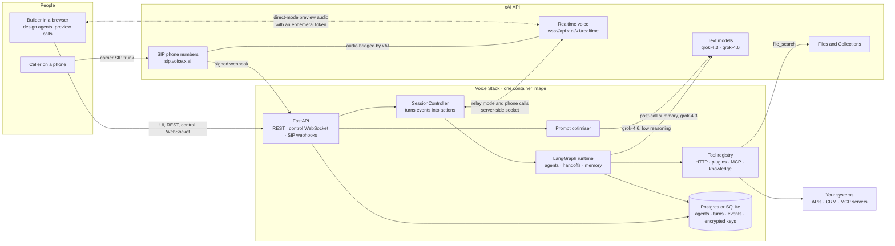
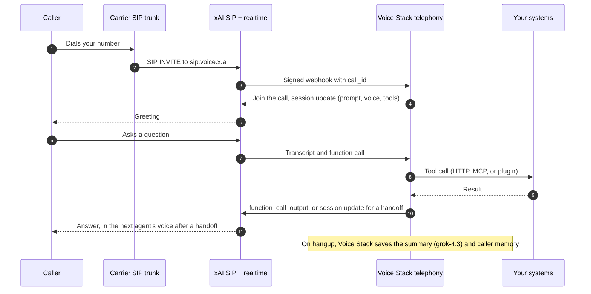
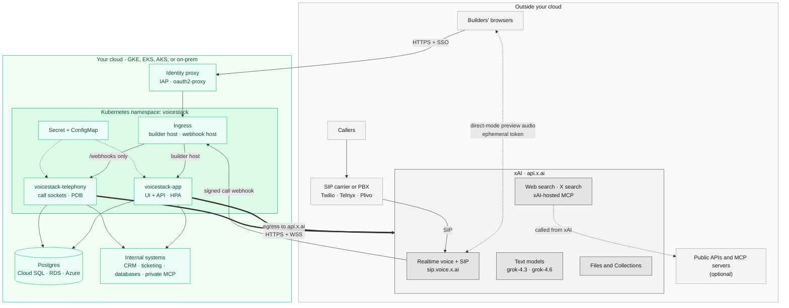

# Voice Stack

Voice Stack is an open-source, self-hostable builder for voice agents on xAI's speech-to-speech model (`grok-voice-think-fast-2.0`). Use it as a working base: deploy it as-is, then extend it with your own connectors and data.

You design a **landscape** of agents. Each agent has a prompt, a voice, a speaking speed, tools, and knowledge. Handoffs connect the agents and carry typed context from one to the next. You can talk to any agent in the browser, read every conversation back in full, and route real phone numbers to agents over SIP.

It is built on public xAI APIs:

- the realtime voice API (`wss://api.x.ai/v1/realtime`) and ephemeral tokens
- text to speech, built-in voices, and custom voices
- the Files API and Collections for knowledge
- Remote MCP, plus web search and X search
- SIP phone numbers

LangGraph orchestrates each conversation, and LangChain provides the tools, MCP adapters, and retrieval. A built-in prompt optimiser uses `grok-4.6` with low reasoning and xAI's voice prompting guide.

## Features

| Area | What you get |
|---|---|
| Agents | Agents stored as data: prompt, greeting, voice, speed, tools, knowledge, and versioned publishing. Editing a draft never changes what callers hear. |
| Handoffs | Agent-to-agent transfer with a context contract (fields the next agent needs). The full transcript follows the caller, and the voice can change mid-call. |
| History and memory | One thread per conversation across agents. Post-call summaries, plus caller memory keyed by phone number or caller identity. |
| Landscape | A live graph of agents and handoffs. Edges pulse when a transfer happens during a call. |
| Live preview | Talk to any agent in the browser, in direct mode (the browser holds the xAI socket with an ephemeral token) or relay mode (audio goes through the server). |
| Tools | HTTP tools, Python code plugins, MCP servers (hosted by xAI or run by Voice Stack), web search, X search, and end-call. |
| Knowledge | Per-agent RAG over your own files, stored in xAI Collections (default) or in a local LangChain index. |
| Prompting | A linter and an optimiser that rewrites a prompt against xAI's prompting guide. You get a per-section diff and a reason for each change. |
| Voices | Built-in voices with previews, speed control, and custom voices. Custom voices are available only in the United States, excluding Illinois. Teams in other countries need to contact xAI sales. |
| Telephony | SIP primitives: register numbers, verify signed webhooks, route calls to agents, transfer (REFER), and hang up. Includes carrier steps for Twilio, Telnyx, Plivo, or a PBX. |
| Recording | Every turn, every tool call with its arguments and output, the realtime event log, and handoff context. |
| Security | Bring your own key (BYOK), keys encrypted at rest, ephemeral tokens for browsers, an SSRF guard for tools, and an optional token or identity-proxy login. |
| Deploy | One container image. Docker Compose, Cloud Run (two services: builder and telephony), and Kubernetes manifests. |
| Agents as code | Export the landscape as YAML and apply it with `voicestack apply -f`. |

## How it works

xAI's realtime model runs every conversation. Voice Stack is the control plane around it: it stores agents, compiles each agent into a realtime `session.update`, executes tools, routes handoffs, keeps history, and answers phone calls. The same LangGraph graph serves browser previews and phone calls.



A phone call, step by step:



See [`docs/architecture.md`](docs/architecture.md) for the components and the LangGraph runtime.

## Requirements

- Python 3.12+ and [uv](https://docs.astral.sh/uv/)
- Node.js 20.19+ or 22.12+ and npm
- An xAI API key from [console.x.ai](https://console.x.ai). This regular API key runs everything, including knowledge in xAI Collections. You do not need a Management API key.
- Docker (optional, for the Compose setup)

## Quick start

```bash
git clone https://github.com/arhamtalkstech/grok-voicestack.git
cd grok-voicestack
cp .env.example .env        # optional: set XAI_API_KEY here, or add a key in the UI later
```

Start the backend in one terminal:

```bash
cd backend
uv sync
uv run voicestack serve --reload      # API on http://localhost:8000
```

Start the UI in a second terminal:

```bash
cd frontend
npm install
npm run dev                            # UI on http://localhost:5173
```

Open http://localhost:5173. A sample help line (Front Desk → API Guide / Voice Specialist) is created on first run. Add your key in **Settings**, then press **Start call**.

Check the setup at any time:

```bash
cd backend && uv run voicestack doctor --url http://localhost:8000
```

### With Docker

```bash
deploy/compose/up.sh        # starts the app and Postgres, then runs voicestack doctor
```

Open http://localhost:8000.

## Env

| Variable | Required | What it is |
|---|---|---|
| `XAI_API_KEY` | no | Server-side xAI key. You can also save a key in Settings or use a session-only key in the browser. Phone calls need a server-side key. Never commit it. |
| `APP_ENCRYPTION_KEY` | production | Encrypts stored API keys, webhook secrets, and tool secrets (AES-GCM). |
| `DATABASE_URL` | production | Postgres URL. Empty means SQLite in `DATA_DIR`. |
| `AUTH_MODE` / `ADMIN_TOKEN` | production | Builder access: `none`, `token`, or `proxy` (IAP, Cloudflare Access). |
| `PUBLIC_BASE_URL` | for SIP | Public HTTPS URL that xAI sends call webhooks to. |
| `ROLE` | no | `all`, `app` (UI + API), or `telephony` (webhooks + call workers). |
| `VOICE_MODEL` / `TEXT_MODEL` | no | Defaults `grok-voice-latest` / `grok-4.3` (summaries, X search). Pin the voice model version in production. |
| `OPTIMIZER_MODEL` / `OPTIMIZER_REASONING_EFFORT` | no | Prompt optimiser. Defaults `grok-4.6` / `low`. `grok-4.6` cannot turn reasoning off, so `low` is the lightest setting. |
| `HANDOFF_VOICE_MODE` | no | `in_session` (switch voice on handoff) or `keep`. |
| `EMBEDDINGS_PROVIDER` | no | For local knowledge bases: `fastembed` (local, no key) or `openai_compatible`. |
| `RECORD_EVENTS` | no | Store the realtime event log for each conversation (default on). |

The full list with comments is in [`.env.example`](.env.example).

## Try it

1. **Landscape:** open the graph of agents, handoff edges with their context fields, and entry points. Drag from one card to another to add a handoff.
2. **Talk to an agent:** press **Start call** and ask the Front Desk about building a phone agent. It hands off to the Voice Specialist: the voice changes, and the edge pulses on the Landscape.
3. **Edit live:** change an agent's speed or prompt during the call. The change applies to the running session.
4. **Optimise a prompt:** on an agent's Prompt tab, choose **Optimise with guide**. Review the per-section diff and the lint scores before and after.
5. **Tools and knowledge:** run the GitHub HTTP tool and the DeepWiki MCP server from Integrations. Upload a PDF to Knowledge and ask the Voice Specialist about it.
6. **Conversations:** open a finished call to see one thread across agents, each tool call with its arguments and output, the context passed at each handoff, the event log, and the summary. Call again with the same caller identity, and the agent remembers the caller.
7. **Telephony:** register a number on your SIP trunk, then copy the SIP URI and the carrier steps.
8. **Agents as code:** export the landscape as YAML from Settings, edit it, and apply it with `voicestack apply -f`.

## CLI

```bash
cd backend
uv run voicestack serve                         # API and built UI
uv run voicestack doctor [--url URL]            # config, database, xAI key, running instance
uv run voicestack export > landscape.yaml       # agents, handoffs, tools, connectors as YAML
uv run voicestack apply -f landscape.yaml       # create or update from YAML
uv run voicestack prompt optimize --help        # rewrite a prompt against the prompting guide
uv run voicestack sip --help                    # SIP helpers, including a signed-webhook simulator
uv run voicestack deploy compose --dry-run      # deployment scripts: compose, cloudrun, k8s
```

## Deploy

| Target | Guide | Script |
|---|---|---|
| Laptop or one VM | [`docs/deploy/local.md`](docs/deploy/local.md) | `deploy/compose/up.sh` |
| Google Cloud Run | [`docs/deploy/cloudrun.md`](docs/deploy/cloudrun.md) | `deploy/cloudrun/deploy.sh` |
| Kubernetes | [`docs/deploy/kubernetes.md`](docs/deploy/kubernetes.md) | `deploy/k8s/apply.sh` |
| Anything that runs containers | [`docs/deploy/other-platforms.md`](docs/deploy/other-platforms.md) | `Dockerfile` |

In production, run two services from the same image: `ROLE=app` for the builder (behind an identity proxy) and `ROLE=telephony` for phone calls.

The [`.grok/skills/`](.grok/skills/) folder has runbooks a coding agent can follow: deploy to Cloud Run, Compose, or Kubernetes; register a SIP number; add a connector; add a knowledge provider. They are plain Markdown.

### Running on Kubernetes in your cloud

Voice Stack runs in your cluster as two Deployments from one image. Everything it stores stays in your cloud: agents, conversations, transcripts, event logs, caller memory, and encrypted keys. The speech itself runs at xAI. Callers and carriers talk to xAI, and xAI calls your cluster only for the signed call webhook.



| Component | Where it runs | What it does |
|---|---|---|
| `voicestack-app` | Your cluster | Builder UI and API, browser previews, the prompt optimiser. Scales with an HPA. |
| `voicestack-telephony` | Your cluster | Receives call webhooks and holds one realtime socket per call. A PodDisruptionBudget and a one-hour grace period let calls finish during rollouts. |
| Postgres | Your cloud (managed or in-cluster) | Agents, versions, conversations, turns, event logs, LangGraph checkpoints and caller memory, encrypted API keys and tool secrets, and local-mode knowledge chunks. |
| Identity proxy | Your cloud | Puts the builder behind your SSO (`AUTH_MODE=proxy`). |
| Internal systems | Your cloud | Called by HTTP tools, code plugins, and MCP servers run by Voice Stack. They never need to be public. |
| xAI API | Outside, at xAI | Speech-to-speech model, SIP termination, text models, ephemeral tokens, voices, Collections, and web and X search. |
| SIP carrier or PBX | Outside | Points your phone numbers at `sip.voice.x.ai`. It never connects to your cluster. |
| Builders' browsers | Outside | Load the UI through the identity proxy. In direct mode they also hold the call audio socket to xAI with a short-lived ephemeral token. They never receive your API key. |

Network rules:

- **Inbound:** two hostnames on the Ingress. The builder host sits behind your identity proxy. The webhook host is public but routes only `/webhooks` and `/healthz` to telephony pods, and every webhook is checked against the number's signing secret.
- **Outbound:** `api.x.ai` over HTTPS and WSS from both Deployments, plus whatever internal or public systems your tools call. Local-mode knowledge downloads its embedding model from Hugging Face on first use, unless the image is built with `--build-arg PRELOAD_EMBEDDINGS=true`.
- **Browsers:** direct-mode previews need WSS to `api.x.ai` from the builder's network. Relay mode sends preview audio through your cluster instead.

What reaches xAI: call audio, transcripts, agent prompts and tool results during a call, text sent to the optimiser and post-call summaries, and documents in Collections-mode knowledge bases. Local-mode knowledge bases keep documents and embeddings in your Postgres. Tools that xAI hosts (xAI-hosted MCP, web search, X search) are called from xAI, so any MCP server in xAI-hosted mode must be reachable from the internet. Use MCP run by Voice Stack for private servers.

Step-by-step setup is in [`docs/deploy/kubernetes.md`](docs/deploy/kubernetes.md) and the `deploy-kubernetes` skill.

## Docs

| Topic | Doc |
|---|---|
| Architecture and the LangGraph runtime | [`docs/architecture.md`](docs/architecture.md) |
| Building agents | [`docs/building-agents.md`](docs/building-agents.md) |
| Prompting and the optimiser | [`docs/prompting.md`](docs/prompting.md) |
| Handoffs | [`docs/handoffs.md`](docs/handoffs.md) |
| History, memory, and recording | [`docs/history-and-memory.md`](docs/history-and-memory.md) |
| Tools and MCP | [`docs/tools-and-mcp.md`](docs/tools-and-mcp.md) |
| Knowledge (RAG) | [`docs/knowledge.md`](docs/knowledge.md) |
| Telephony and SIP | [`docs/telephony-sip.md`](docs/telephony-sip.md) |
| BYOK and security | [`docs/byok-and-security.md`](docs/byok-and-security.md) |
| Extending Voice Stack | [`docs/extending.md`](docs/extending.md) |
| Testing | [`docs/testing.md`](docs/testing.md) |
| Verified xAI API behavior | [`docs/xai-api-notes.md`](docs/xai-api-notes.md) |

### xAI speech docs

[`xai-speech-docs/`](xai-speech-docs/) has markdown copies of xAI's public voice documentation: speech to speech, SIP phone calls, the voice prompting guide, text to speech, speech to text, custom voices, ephemeral tokens, the API reference, WebSocket schemas, and voice cookbook examples. Give them to a coding agent or read them offline. Refresh them with `xai-speech-docs/fetch.sh`.

## Testing

```bash
cd backend
uv run pytest tests/unit -q                              # no network
XAI_API_KEY=... uv run pytest tests/live -m live         # real calls to xAI
XAI_API_KEY=... uv run python spikes/phase0.py           # re-check API behavior, writes docs/xai-api-notes.md
uv run ruff check src tests spikes

cd ../frontend
npm run typecheck
XAI_API_KEY=... npm run e2e                              # spoken calls in a browser (servers running)
```

The live tests and the browser test make real, billed calls. See [`docs/testing.md`](docs/testing.md) for what each test covers and the latest results.

## Layout

```
backend/            FastAPI + LangGraph/LangChain (package `voicestack`)
  src/voicestack/   api/ runtime/ (graph, controller, transports) prompting/ tools/ knowledge/ telephony/ xai/ security/
  tests/            unit/ (no network) and live/ (needs XAI_API_KEY)
  spikes/phase0.py  checks API behaviors the docs do not cover and writes docs/xai-api-notes.md
frontend/           React + Vite UI; src/audio (worklets, realtime client), src/voiceprint, e2e/ (live browser test)
deploy/             compose/, cloudrun/, k8s/ scripts and manifests
docs/               design and how-to docs
xai-speech-docs/    markdown copies of xAI's voice docs; refresh with ./fetch.sh
examples/           landscapes/front-desk.yaml, plugins/open_meteo.py
.grok/skills/       runbooks a coding agent can follow
```

## Contributing

Issues and pull requests are welcome. Read [`AGENTS.md`](AGENTS.md) first: it has the commands and the rules for changes. Add a test with each change.

## License

Apache-2.0. See [`LICENSE`](LICENSE) and [`NOTICE`](NOTICE). The files in `xai-speech-docs/` are xAI's documentation and are not covered by this license.

---

<sub>Voice Stack is an independent community project. It is not an official xAI repository and is not maintained or endorsed by xAI. It uses xAI's Grok models and public APIs; "Grok" and "xAI" are trademarks of their owner.</sub>
